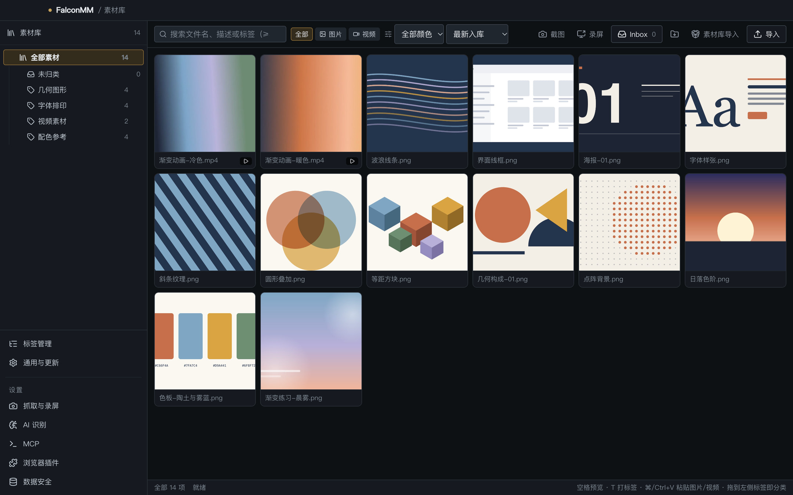
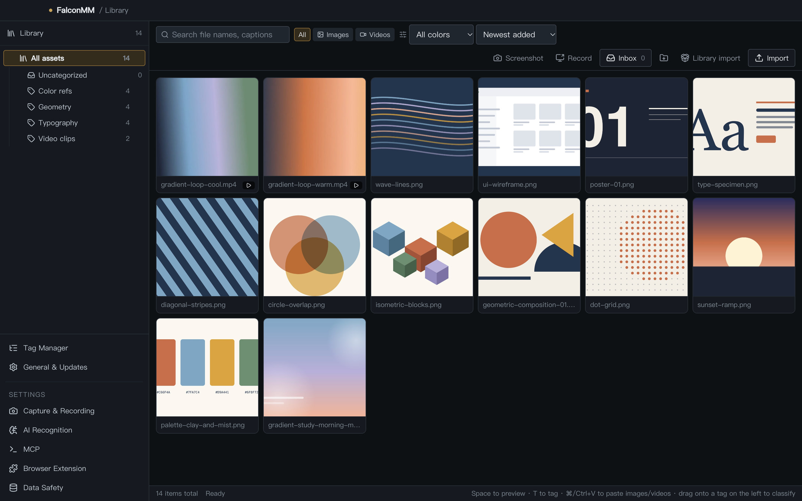

# FalconMM

**简体中文** ｜ FalconMM 是一款本地优先的素材库应用：截屏、录屏、浏览器抓取的内容先进入收件箱审核，再归入标签树整理；可选接入视觉模型（VLM）自动打标签，并通过 MCP 供 AI 助手检索。支持 macOS（Apple 芯片 / Intel）与 Windows，内置 11 种界面语言与自动更新。

**English** ｜ FalconMM is a local-first media library: screenshots, screen recordings and browser captures go to an inbox for review, then into a tag tree; with optional VLM auto-tagging and MCP access for AI assistants. Runs on macOS (Apple silicon / Intel) and Windows, with 11 interface languages and a built-in auto-updater.

## ⬇ 下载安装 / Download

**最新版本 Latest release：[v0.4.0](https://github.com/darker2016/FalconMMRelease/releases/tag/v0.4.0)** ｜ [全部版本 All releases](https://github.com/darker2016/FalconMMRelease/releases)

安装包挂在 Release 页面的 Assets 里（仓库文件列表中不放安装包）。 / Installers are attached to each release under **Assets**.

| 平台 Platform | 安装包 Installer | 说明 Notes |
| --- | --- | --- |
| macOS · Apple 芯片 / Apple silicon | [**FalconMM-0.4.0-arm64.dmg**](https://github.com/darker2016/FalconMMRelease/releases/download/v0.4.0/FalconMM-0.4.0-arm64.dmg) | 打开 DMG，把 FalconMM 拖进「应用程序」 / Open the DMG and drag FalconMM into **Applications** |
| macOS · Intel | [**FalconMM-0.4.0-x64.dmg**](https://github.com/darker2016/FalconMMRelease/releases/download/v0.4.0/FalconMM-0.4.0-x64.dmg) | 同上 / Same as above |
| Windows 10 / 11 · x64 | [**FalconMM-Setup-0.4.0.exe**](https://github.com/darker2016/FalconMMRelease/releases/download/v0.4.0/FalconMM-Setup-0.4.0.exe) | 双击，按向导安装 / Run the setup wizard |
| 浏览器插件 / Browser extension（Chrome · Edge） | [**FalconMM-Extension-0.4.0.zip**](https://github.com/darker2016/FalconMMRelease/releases/download/v0.4.0/FalconMM-Extension-0.4.0.zip) | 解压后「加载已解压的扩展程序」 / Unzip, then **Load unpacked** |

- macOS 安装包未做公证：首次打开请右键 → 打开。 / The macOS builds are not notarized: right-click → **Open** on first launch.
- 应用会自动检查本仓库的新版本：Windows 静默升级，macOS 打开新 DMG 引导安装。 / The app checks this repository for updates automatically: silent in-place upgrade on Windows, DMG install on macOS.

## 界面预览 / Screenshots

| 简体中文 | English |
| :---: | :---: |
|  |  |
| 主界面 · 素材库与标签树 | Main window · library and tag tree |

截图使用合成演示素材。 / Screenshots use synthetic demo assets.

## 使用说明 / User guide

每种语言一份独立文件，覆盖安装、界面语言、软件更新、浏览器插件、常用功能、插件开发与常见问题。 / One standalone guide per language: install, interface language, updates, browser extension, everyday features, extension development and FAQ.

| | |
| --- | --- |
| [简体中文](docs/UserGuide.zh-CN.html) | [English](docs/UserGuide.en.html) |
| [繁體中文](docs/UserGuide.zh-TW.html) | [日本語](docs/UserGuide.ja.html) |
| [한국어](docs/UserGuide.ko.html) | [Français](docs/UserGuide.fr.html) |
| [Deutsch](docs/UserGuide.de.html) | [Español](docs/UserGuide.es.html) |
| [Português](docs/UserGuide.pt.html) | [Русский](docs/UserGuide.ru.html) |
| [العربية](docs/UserGuide.ar.html) |  |
| [全部语言 / All languages](docs/UserGuide.html) |  |

## 浏览器插件 / Browser extension

- 支持站点 / Supported sites：哔哩哔哩 Bilibili · 抖音 Douyin · 小红书 Xiaohongshu · YouTube · TikTok · X (Twitter) · Instagram · Vimeo
- 插件只解析媒体地址，下载与入库由 FalconMM 桌面端完成（带站点 Referer，自动合并分离的音视频轨）。 / The extension only resolves media URLs; the FalconMM desktop app downloads (with the site's Referer) and imports them.
- **源码与开发者指南 / Source code & developer guide**：[extension-source/](extension-source/) · [DEVELOPER.md](extension-source/DEVELOPER.md)。新增站点只需修改插件，握手时会自动向桌面端登记。 / Add a site by editing the extension only — new sites are registered with the desktop app automatically.

## 多语言简介 · Introduction in 11 languages

**简体中文** — FalconMM 是一款本地优先的素材库：截屏、录屏与浏览器抓取的内容先进入收件箱审核，再归入标签树。界面支持 11 种语言（默认跟随系统），应用内置自动更新，会自动检查本发布库的最新版本。浏览器插件支持哔哩哔哩 / 抖音 / 小红书 / YouTube / TikTok / X / Instagram / Vimeo 的视频下载，插件源码已在 extension-source/ 开放。

**繁體中文** — FalconMM 是一款本地優先的素材庫：截圖、錄屏與瀏覽器擷取的內容先進入收件箱審核，再歸入標籤樹。介面支援 11 種語言（預設跟隨系統），應用內建自動更新，會自動檢查本發布庫的最新版本。瀏覽器擴充功能支援 Bilibili／抖音／小紅書／YouTube／TikTok／X／Instagram／Vimeo 的影片下載，擴充功能原始碼已在 extension-source/ 開放。

**English** — FalconMM is a local-first media library: screenshots, screen recordings, and browser captures go to an inbox for review, then are organized into a tag tree. The UI ships in 11 languages (defaults to your system language), and the app includes a built-in auto-updater that checks this release repository. The browser extension downloads videos from Bilibili/Douyin/Xiaohongshu/YouTube/TikTok/X/Instagram/Vimeo, with its source code openly available in extension-source/.

**日本語** — FalconMM はローカルファーストのメディアライブラリです。スクリーンショット・画面録画・ブラウザキャプチャを一旦受信箱で確認し、タグツリーに整理します。UI は 11 言語に対応（既定ではシステム言語に従います）し、アプリ内蔵の自動アップデートが本リリースリポジトリをチェックします。ブラウザ拡張は Bilibili／Douyin／小紅書（Xiaohongshu）／YouTube／TikTok／X／Instagram／Vimeo の動画ダウンロードに対応し、拡張のソースコードは extension-source/ で公開しています。

**한국어** — FalconMM은 로컬 우선 미디어 라이브러리입니다. 스크린샷, 화면 녹화, 브라우저 캡처가 수신함 검토를 거친 뒤 태그 트리로 정리됩니다. UI는 11개 언어를 지원하며(기본값은 시스템 언어), 앱에 내장된 자동 업데이트가 이 릴리스 저장소를 확인합니다. 브라우저 확장은 Bilibili/Douyin/Xiaohongshu/YouTube/TikTok/X/Instagram/Vimeo 영상 다운로드를 지원하며, 확장 소스 코드는 extension-source/에서 공개됩니다.

**Français** — FalconMM est une médiathèque locale d'abord : les captures d'écran, les enregistrements d'écran et les captures de navigateur passent par une boîte de réception pour validation, puis sont classés dans une arborescence de tags. L'interface est disponible en 11 langues (par défaut, celle du système) et l'application intègre une mise à jour automatique qui vérifie ce dépôt de versions. L'extension de navigateur télécharge les vidéos de Bilibili/Douyin/Xiaohongshu/YouTube/TikTok/X/Instagram/Vimeo ; son code source est ouvert dans extension-source/.

**Deutsch** — FalconMM ist eine Local-First-Mediathek: Screenshots, Bildschirmaufnahmen und Browser-Mitschnitte landen zunächst im Posteingang zur Prüfung und werden dann in einen Tag-Baum einsortiert. Die Oberfläche ist in 11 Sprachen verfügbar (Standard ist die Systemsprache), und die App bringt einen Auto-Updater mit, der dieses Release-Repository prüft. Die Browser-Erweiterung lädt Videos von Bilibili/Douyin/Xiaohongshu/YouTube/TikTok/X/Instagram/Vimeo herunter; ihr Quellcode liegt offen unter extension-source/.

**Español** — FalconMM es una biblioteca multimedia local primero: las capturas de pantalla, las grabaciones de pantalla y las capturas del navegador pasan por una bandeja de entrada para revisión y luego se organizan en un árbol de etiquetas. La interfaz está disponible en 11 idiomas (por defecto, el del sistema) y la aplicación incluye una actualización automática que comprueba este repositorio de versiones. La extensión de navegador descarga vídeos de Bilibili/Douyin/Xiaohongshu/YouTube/TikTok/X/Instagram/Vimeo; su código fuente está abierto en extension-source/.

**Português** — FalconMM é uma biblioteca de mídia local-first: capturas de tela, gravações de tela e capturas do navegador passam por uma caixa de entrada para revisão e depois são organizadas em uma árvore de etiquetas. A interface está disponível em 11 idiomas (por padrão, o do sistema) e o aplicativo traz uma atualização automática que verifica este repositório de versões. A extensão de navegador baixa vídeos de Bilibili/Douyin/Xiaohongshu/YouTube/TikTok/X/Instagram/Vimeo; o código-fonte dela está aberto em extension-source/.

**Русский** — FalconMM — это локальная медиатека (local-first): скриншоты, записи экрана и захваты из браузера сначала попадают во входящую очередь для проверки, а затем раскладываются по дереву тегов. Интерфейс доступен на 11 языках (по умолчанию — язык системы), а в приложении есть автообновление, которое проверяет этот репозиторий релизов. Браузерное расширение скачивает видео с Bilibili/Douyin/Xiaohongshu/YouTube/TikTok/X/Instagram/Vimeo; его исходный код открыт в extension-source/.

**العربية** — FalconMM مكتبة وسائط تعمل محليًا أولاً: لقطات الشاشة وتسجيلات الشاشة والالتقاط من المتصفح تمرّ عبر صندوق الوارد للمراجعة، ثم تُنظَّم في شجرة وسوم. تدعم الواجهة 11 لغة (افتراضيًا لغة النظام)، ويشتمل التطبيق على تحديث تلقائي يفحص هذا المستودع. إضافة المتصفح تتيح تنزيل مقاطع الفيديو من Bilibili/Douyin/Xiaohongshu/YouTube/TikTok/X/Instagram/Vimeo، وكود المصدر الخاص بها متاح في extension-source/.

## 安全说明 / Security notes

- 本地优先 / Local-first：素材库、数据库与设置全部保存在本机，不上传任何远端。 / The library, database and settings stay on your machine.
- AI 打标签默认关闭，需自行配置模型端点（本地 Ollama 或任意 OpenAI 兼容服务）。 / VLM tagging stays off until you configure a model endpoint yourself.
- 不做 DRM：爱奇艺 / 优酷 / 腾讯视频 / 芒果TV 等版权保护内容不提供下载。 / DRM-protected content (iQIYI, Youku, Tencent Video, MangoTV, …) is not supported for download.
- 本仓库只放发布产物（安装包、浏览器插件、使用说明、插件源码），不放应用源码。 / Release artifacts only — the application source code is not published here.
